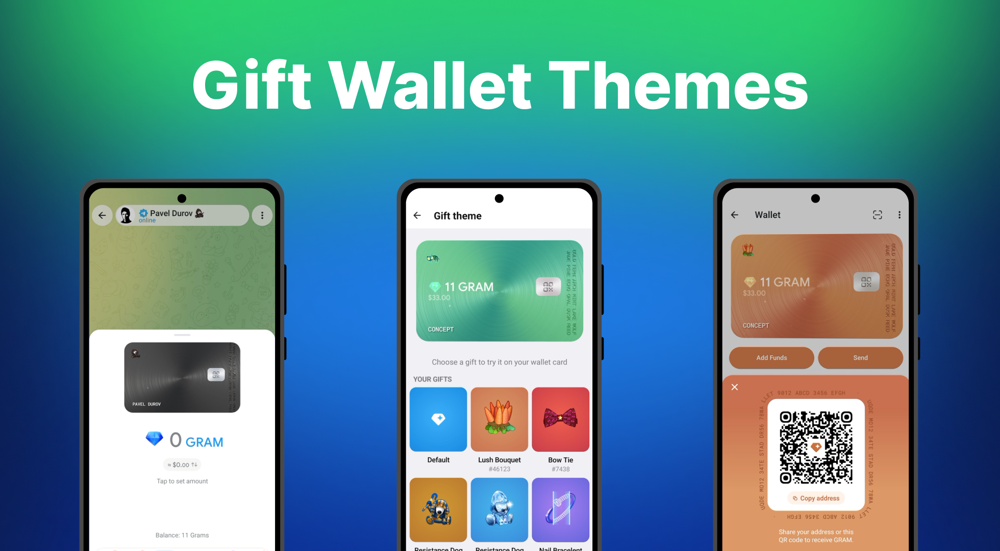

# Wallet gift themes and card stickers (Telegram Wallet concept)

Two ideas for the Telegram Wallet, both built as working prototypes:

1. **Gift themes** – dress the Gram Wallet card in a gift you own: the card takes the gift's backdrop colours and shows its
   animated model. Buttons, receive sheet, history and the "You sent X Grams" messages in chats follow the same colours.
2. **Card stickers (web recreation)** – a browser version of the card where gifts can be dropped on the card as static
   stickers, moved, scaled, rotated and removed. It reproduces how this works in Telegram Beta-2 (see below).

> Unofficial fan concept. Not affiliated with or endorsed by Telegram.

## What is here

| Folder | What it is |
|---|---|
| [`patch/`](patch) | Gift themes as ready-to-integrate code for the Android client (Java, GLSL shaders, resources) with its own [README](patch/README.md) |
| [`web/`](web) | Browser demo of the card with gift stickers. No build step: open `web/index.html` |
| [`docs/`](docs) | Design reference |

Post with the demo video: https://t.me/NFTstyler/50

## Web demo

Open `web/index.html` (or run `python -m http.server` in `web/` and visit `http://localhost:8000`). Needs internet for the
`lottie-web` script (cdnjs) and the fonts.

* The card is a WebGL brushed-metal shader with a CSS 3D tilt: drag the card.
* **Drag** a gift from the list onto the card: it lands exactly where you drop it. Only the QR chip can't be covered;
  texts darken under a sticker. **Hold** a gift (or right-click) for *Add to card* / *Apply colour*.
* *Add to card* and a fast fling use the automatic placement (a port of the client's scoring algorithm).
* **Tap** a sticker to select it: drag the two handles to scale and rotate (snaps every 90°). Drag it off the card or onto
  *Remove* to take it off. Max 10 stickers, the 11th replaces the oldest.
* *Apply colour* spreads the gift's colours and pattern over the card from the sticker; it leaves with the sticker.

Details of every rule are in [`web/README.md`](web/README.md). The behaviour was derived by reading the decompiled
Telegram Beta-2 Android client (`TL_wallet.card`, `cardSticker`, `MediaAreaCoordinates`, the placement and gesture code).
The card look itself is a hand-written reconstruction, not the original renderer.

## Gift themes patch

See [`patch/README.md`](patch/README.md): the idea, every file, the integration points and how the shaders are generated.

## Notes on third-party material

* The Android patch is written for the Telegram client, which is licensed under GPLv2; `patch/` follows the same terms.
* The gift models in `web/gifts-data.js` and `patch/res/raw` are animations of Telegram gifts, used here only to make the
  demo work. They belong to their respective authors / Telegram.
